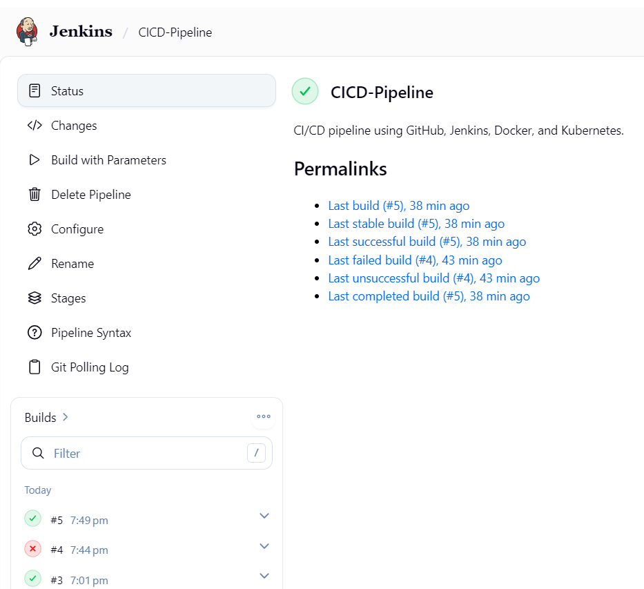
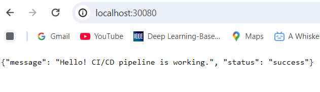

# CI/CD Pipeline Setup with Git, Jenkins, Docker, and Kubernetes

## 1. Overview

This project demonstrates a Continuous Integration and Continuous Deployment (CI/CD) pipeline using Git, GitHub, Jenkins, Docker, and Kubernetes.

Jenkins checks out the source code from GitHub, validates the required project files, builds a Docker image, verifies Kubernetes access, deploys the application, and checks the deployment rollout.

## 2. Architecture

```text
Developer
    |
    v
  GitHub
    |
    v
  Jenkins
    |
    v
Validate Project Files
    |
    v
Build Docker Image
    |
    v
Verify Kubernetes Access
    |
    v
Deploy to Kubernetes
    |
    v
Kubernetes Service
    |
    v
Application Endpoint
```

## 3. Technologies Used

- **Version Control:** Git and GitHub
- **CI/CD:** Jenkins
- **Containerization:** Docker
- **Container Orchestration:** Kubernetes
- **Application:** Python HTTP server
- **Cluster Management:** kubectl
- **Local Environment:** Windows and Docker Desktop

## 4. Prerequisites

Install and configure the following tools:

- Git
- Jenkins
- Java compatible with the installed Jenkins version
- Docker Desktop
- Kubernetes enabled in Docker Desktop
- kubectl

Ensure Jenkins can access Docker and the configured Kubernetes cluster.

## 5. Project Structure

```text
CICD-Pipeline/
├── app/
│   └── app.py
├── k8s/
│   ├── deployment.yaml
│   └── service.yaml
├── Dockerfile
├── Jenkinsfile
└── README.md
```

## 6. Jenkins Configuration

1. Create a Jenkins Pipeline job named `CICD-Pipeline`.
2. Select **Pipeline script from SCM**.
3. Select **Git** as the source control management system.
4. Enter the GitHub repository URL.
5. Set the branch to `*/main`.
6. Set the Script Path to `Jenkinsfile`.
7. Configure Git credentials if the repository is private.
8. Ensure the Jenkins service account has the required Docker and Kubernetes access.

## 7. Automatic Builds Using Poll SCM

To check the GitHub repository for changes periodically:

1. Open the `CICD-Pipeline` job in Jenkins.
2. Select **Configure**.
3. Under **Build Triggers**, enable **Poll SCM**.
4. Enter the following schedule:

   ```text
   H/5 * * * *
   ```

5. Save the configuration.

Jenkins checks the repository periodically and starts a build when it detects relevant source changes. Polling does not necessarily start a build every five minutes if there are no changes.

A GitHub webhook is another option when Jenkins is reachable by GitHub.

## 8. Kubernetes Configuration

The pipeline uses the Kubernetes context configured in the Jenkins kubeconfig.

**Default Kubernetes context:**

```text
docker-desktop
```

**Kubeconfig path:**

```text
C:\ProgramData\Jenkins\.jenkins\.kube\config
```

The `KUBE_CONTEXT` build parameter can select another Kubernetes context that is already configured and accessible to Jenkins.

Do not commit kubeconfig files, access tokens, certificates, passwords, or other secrets to GitHub.

## 9. Running the Pipeline

1. Push the project files to the configured GitHub repository.
2. Open the `CICD-Pipeline` job in Jenkins.
3. Select **Build Now**, or wait for SCM polling to detect a change.
4. Open the build's **Console Output**.
5. Verify that the pipeline stages complete successfully.

The current pipeline builds and deploys the Docker image:

```text
cicd-app:1.0
```

## 10. Verifying the Deployment

Run the following commands in a terminal configured to access the target Kubernetes cluster:

```bash
kubectl get deployment cicd-app
kubectl get pods
kubectl get service cicd-app-service
kubectl rollout status deployment/cicd-app
```

Open the application endpoint:

[http://localhost:30080](http://localhost:30080)

Expected response:

```json
{
  "message": "Hello! CI/CD pipeline is working.",
  "status": "success"
}
```

## 11. Screenshots

The following screenshots demonstrate the successful pipeline execution and application response.

### Jenkins Pipeline Success



*The Jenkins build showing successful pipeline execution.*

### Application Response



*The application returning the expected JSON response.*

## 12. Troubleshooting

- **Docker build fails:** Verify that Docker Desktop is running and Jenkins can execute Docker commands.
- **Kubernetes access fails:** Check the kubeconfig path, file permissions, and Kubernetes context.
- **Deployment rollout fails:** Run `kubectl describe deployment cicd-app` and inspect the application logs.
- **Application is unreachable:** Check Pod status, Service configuration, endpoints, and port `30080`.
- **Automatic build does not start:** Verify the Git repository URL, branch, and Poll SCM configuration.

## 13. Security and Reliability

- Keep credentials and kubeconfig files outside source control.
- Use Jenkins credentials for private repositories.
- Grant Jenkins only the permissions required for its tasks.
- Use readiness and liveness probes to monitor application health.
- Define appropriate Kubernetes CPU and memory requests and limits.
- Review Jenkins console output when a pipeline fails.
- For production deployments, publish versioned images to a container registry and configure appropriate Kubernetes RBAC.

## 14. Scope and Limitations

This project is a local demonstration using Docker Desktop Kubernetes and a locally built Docker image.

The Kubernetes Deployment uses `imagePullPolicy: Never`, which assumes the image is available in the cluster's local image store.

For a remote Kubernetes cluster, publish the image to a container registry accessible to that cluster and configure registry authentication securely.
